# Offline-to-Online Reinforcement Learning: CS 185/285 Final Project

Final project for **UC Berkeley CS 185/285: Deep Reinforcement Learning, Decision Making, and Control (Spring 2026)**, Option II: *Offline-to-online RL* ([project description](final_project_offline_online/problem/offline_to_online_rl_default_final_project.pdf)). The project consists of implementing, training, tuning and comparing several offline-to-online RL algorithms: SAC+BC, FQL, IFQL, DSRL, QSM, ACFQL and QAM.

In offline-to-online RL, a policy is first trained on a fixed dataset (offline phase) and then fine-tuned by interacting with the environment (online phase). This README is the report of the results.

All experiments run on OGBench environments.

---

## 1. Overview

### Setup

| | |
|---|---|
| Environments | `cube-single-play-singletask-task1-v0` (sanity check), `cube-double-play-singletask-task1-v0`, `antsoccer-arena-navigate-singletask-task1-v0` (state-based OGBench) |
| Budget | 500k offline steps, 100k online steps, 2 seeds |
| Training-time evaluation | 25 episodes every 50k steps (the curves in the plots) |
| Final evaluation | 100 episodes on the final checkpoint (the tables) |

| cube-single: SAC+BC | cube-double: DSRL | antsoccer: IFQL |
|:-:|:-:|:-:|
| 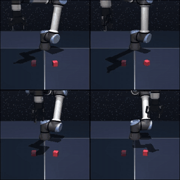 | 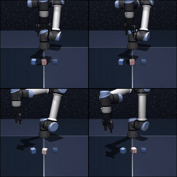 | 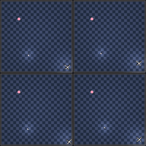 |

Four evaluation episodes per clip, at the end of training (600k steps). cube-single: move one cube to the target. cube-double: move two cubes. antsoccer: the ant dribbles the ball to the goal.

### Implemented methods

| Method | Idea | Code |
|---|---|---|
| SAC+BC | Gaussian SAC actor with a behavior-cloning penalty α | [`sacbc_agent.py`](final_project_offline_online/problem/src/agents/sacbc_agent.py) |
| FQL | Flow-matching BC policy distilled into a one-step Q-maximizing policy | [`fql_agent.py`](final_project_offline_online/problem/src/agents/fql_agent.py) |
| Offline-data retention | Pre-fill the online replay buffer with dataset transitions | [`train_offline_online.py`](final_project_offline_online/problem/src/scripts/train_offline_online.py) |
| WSRL | Collect warm-up rollouts with the frozen offline policy before updating | [`train_offline_online.py`](final_project_offline_online/problem/src/scripts/train_offline_online.py) |
| IFQL | Expectile value learning, flow policy, best-of-N sampling at test time | [`ifql_agent.py`](final_project_offline_online/problem/src/agents/ifql_agent.py) |
| DSRL | RL in the latent-noise space of a flow BC policy | [`dsrl_agent.py`](final_project_offline_online/problem/src/agents/dsrl_agent.py) |
| QSM | Diffusion policy whose score is aligned with ∇ₐQ | [`qsm_agent.py`](final_project_offline_online/problem/src/agents/qsm_agent.py) |
| ACFQL | FQL over action chunks (Q-chunking) | [`qcfql_agent.py`](final_project_offline_online/problem/src/agents/qcfql_agent.py) |
| QAM | Q-learning with adjoint matching on a flow policy | [`qam_agent.py`](final_project_offline_online/problem/src/agents/qam_agent.py) |

---

## 2. Naive offline-to-online RL

The switch from offline to online training is a critical part of the process. The naive approach trains offline, then keeps training the same model on purely online data. The training data then shifts from the dataset to the policy's own experience, which can make performance collapse. The collapse is clearest on harder environments such as cube-double: the *Naive* curve in section 3.1 drops from 48% to 8% after the switch.

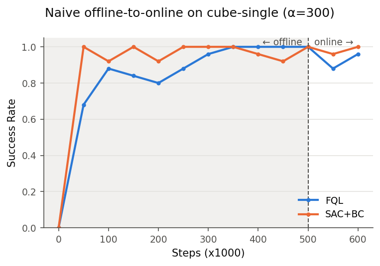

On cube-single, the switch only causes a small dip:

- **FQL** reaches 100% offline, dips to 88% after the switch, and recovers to 96%.
- **SAC+BC** reaches 100% after only 50k offline steps and stays between 92% and 100% for the rest of training. Fine-tuning does not hurt it: 96% at 550k and 100% at 600k (1 seed).

## 3. Improving the offline-to-online transition

Both techniques below change the data the agent trains on at the start of the online phase.

### 3.1 Retaining offline data

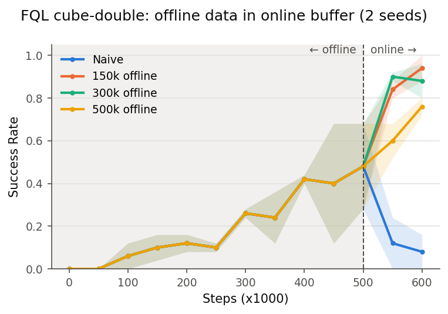

- Pre-filling the online replay buffer with **150k–300k** transitions from the offline dataset prevents the collapse and raises the final success rate to about **90%**. Retaining all **500k** adapts more slowly (**76%**), because the offline data dilutes the new online transitions.

### 3.2 Warm-start RL (WSRL)

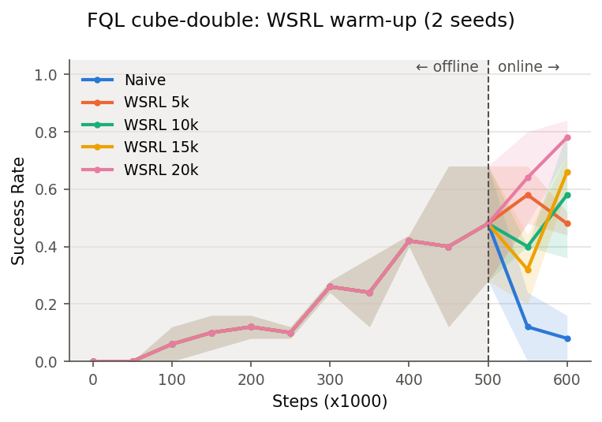

- Longer warm-ups help (**20k** steps → **78%**). However, every warm-up step is one less step of online training, so a longer warm-up uses up more of the fixed budget.

### 3.3 Combining both

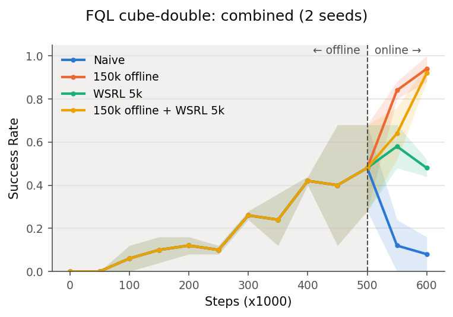

- Both retaining offline data and warming up improve online fine-tuning. We use **150k** retained offline transitions and a **5k-step** WSRL warm-up for all subsequent experiments: the combination ends close to retaining offline data alone (92% vs 94%), while keeping the warm-up short.

## 4. Comparison of all methods

All methods use the setting chosen in section 3.3 (150k retained offline transitions and a 5k-step WSRL warm-up), except ACFQL on antsoccer, which retains all 500k offline transitions. The curves show the mean over 2 seeds, and the shaded area their min/max.

### 4.1 cube-double

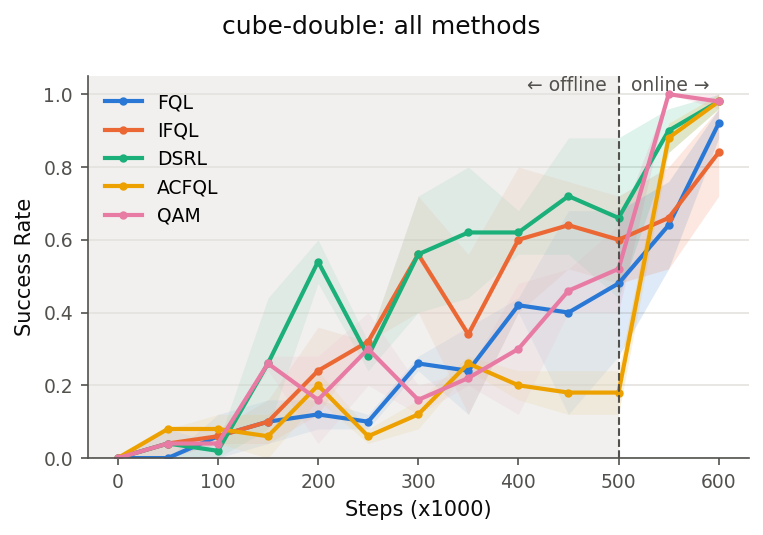

- In the training-time evaluations, every method except IFQL reaches at least 92% after fine-tuning (see section 4.4 for the 100-episode results). The action-chunked methods (ACFQL and QAM) are among the weakest offline but improve the most online: ACFQL goes from 18% to 98% and QAM from 52% to 98%.

| 100k steps (offline) | 500k steps (end of offline) | 600k steps (end of online) |
|:-:|:-:|:-:|
| 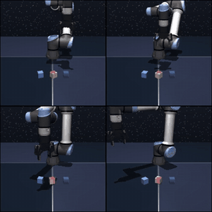 | 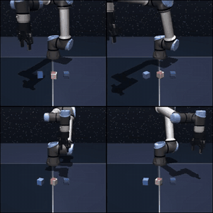 | 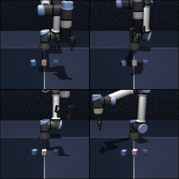 |

QAM (H = 5, η = 1). Training-time evaluation success: 0% at 100k, 32% at 500k and 100% at 600k, when all 4 episodes are solved in about 60 steps. The runs in the plot only rendered the online phase, so the 100k and 500k clips come from an earlier QAM run (seed 8) that rendered every evaluation. The 600k clip is from the plotted run (seed 0).

### 4.2 antsoccer

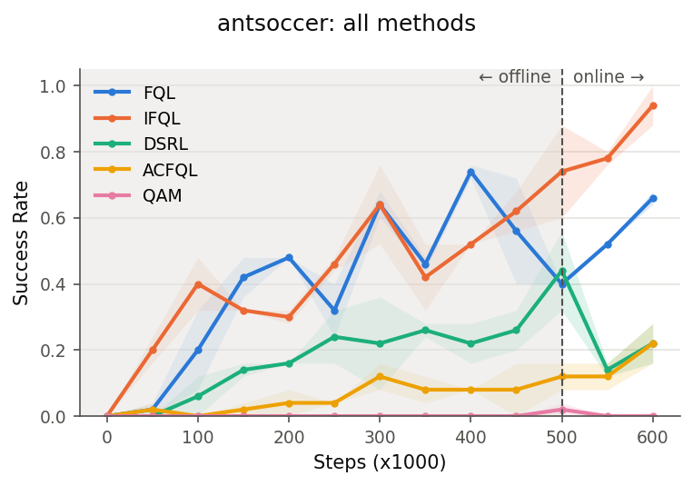

- antsoccer separates the methods much more (training-time evaluations). IFQL is the only method that clearly improves online (from 74% to 94%), and FQL recovers to 66% after a drop at the end of offline training. DSRL drops after the switch, and the action-chunked methods barely learn: ACFQL ends at 22% and QAM at 0%.

| 500k steps (end of offline) | 600k steps (end of online) |
|:-:|:-:|
| 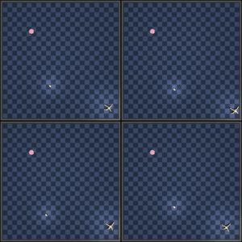 | 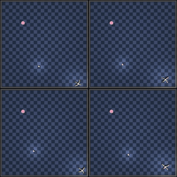 |

IFQL (seed 0), the best method on antsoccer. Training-time evaluation success: 60% at 500k (the 4 rendered episodes all reach the goal, the slowest after 485 steps) and 100% at 600k. No antsoccer run rendered or saved a checkpoint during the offline phase, so there is no 100k clip. The 500k clip was rendered afterwards from the saved end-of-offline checkpoint.

### 4.3 Hyperparameters

| Method | cube-double | antsoccer |
|---|---|---|
| FQL | α = 300 | α = 10 |
| IFQL | τ = 0.9, N = 3 offline and N = 8 online, BC actor frozen online | τ = 0.9, N = 3 offline and N = 8 online, BC actor frozen online |
| DSRL | σz = 0.8 | σz = 1.0 |
| ACFQL | H = 5, α = 300 | H = 5, α = 30, 500k retained offline transitions |
| QAM | H = 5, η = 1 | H = 5, η = 1 |

### 4.4 Final evaluation

Success rate of the final models (600k steps), over 100 episodes per seed. Each cell gives the mean over 2 seeds, with the per-seed values in parentheses.

| Method | cube-double | antsoccer |
|---|:-:|:-:|
| FQL | 86% (78 / 94) | 63% (65 / 61) |
| IFQL | 94% (94 / 93) | **82%** (79 / 85) |
| DSRL | 93% (90 / 95) | 16% (21 / 11) |
| ACFQL | 97% (94 / 100) | 25% (18 / 32) |
| QAM | **98%** (97 / 99) | 0% (0 / 1) |
| *Project target* | *> 95%* | *> 45%* |

- On cube-double, ACFQL and QAM are the only methods above the 95% target. On antsoccer, IFQL and FQL are above the 45% target.

---

## References

- Ball et al., *Efficient Online Reinforcement Learning with Offline Data* (RLPD), 2023
- Hansen-Estruch et al., *IDQL: Implicit Q-Learning as an Actor-Critic Method with Diffusion Policies*, 2023
- Li & Levine, *Q-learning with Adjoint Matching* (QAM), 2026
- Li, Zhou & Levine, *Reinforcement Learning with Action Chunking*, 2025
- Park et al., *OGBench: Benchmarking Offline Goal-Conditioned RL*, ICLR 2025
- Park, Li & Levine, *Flow Q-Learning*, 2025
- Psenka et al., *Learning a Diffusion Model Policy from Rewards via Q-Score Matching*, 2025
- Wagenmaker et al., *Steering Your Diffusion Policy with Latent Space Reinforcement Learning* (DSRL), 2025
- Zhou et al., *Efficient Online Reinforcement Learning Fine-Tuning Need Not Retain Offline Data* (WSRL), 2025

Starter code and project description: [berkeleydeeprlcourse/homework_spring2026](https://github.com/berkeleydeeprlcourse/homework_spring2026/tree/main/final_project_offline_online).
